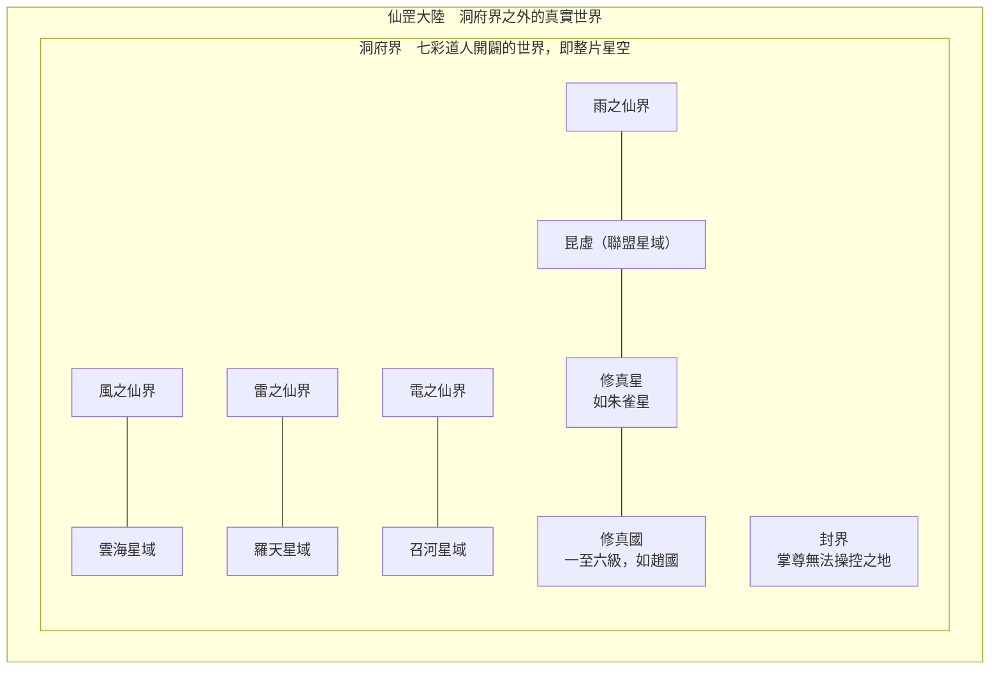

# 《仙逆》世界觀整理

> [!warning] 參考用，不可照搬
> 這篇是研究筆記，記錄的是耳根作品的專屬設定。自己的遊戲只借用類型概念，名稱、人物、劇情都要重新設計，見 [[避免照搬清單]]。

## 總覽：宇宙結構

仙逆的世界是一層套一層的箱子：王林從一個小國走出去，每突破一層，就發現外面還有更大的世界，最後發現整片星空是一座洞府。

風、雨、雷、電四大仙界把星空分成四份，各自對應一片星域。王林由內往外走：修真國 → 修真星 → 星域 → 洞府界 → 仙罡大陸。

## 修煉境界

仙逆把修道分成「步」：第一步七境、第二步五境、第三步四境，第四步「踏天」是傳說中從未有人達到的境界。每跨一步，實力會出現斷層式的差距。

| 步 | 境界 | 特點 |
| --- | --- | --- |
| 第一步（修） | 凝氣 → 築基 → 結丹 → 元嬰 → 化神 → 嬰變 → 問鼎 | 元嬰是分水嶺，之後才算真正的強者；嬰變時脫去凡根、轉為能運行仙力的仙體 |
| 第二步 | 陰虛 → 陽實 → 窺涅 → 淨涅 → 碎涅 | 與第一步截然不同，涅槃三境每一級都是巨大落差；末端要面對天人五衰 |
| 第三步（空之四境） | 空涅 → 空靈 → 空玄 → 空劫 | 空涅為初始、空靈為門檻、空玄為大道、空劫為巔峰；只有入第三步才能對抗五衰 |
| 第四步 | 踏天 | 傳說境界，需走過「踏天橋」的九座橋 |

幾個設計重點：

- **天人五衰是壽命鐘**：第二步的老怪不是缺力量，而是缺「活下去」的路，這讓第三步變成生存問題，不只是追求更強。
- **「步」的語言**：書中把第一步歸納成一個「修」字，每一步代表對道的不同理解，比單純的等級更有哲學感。
- **修為就是政治地位**：一個國家有沒有化神、嬰變修士，直接決定它的修真國等級（見地理節）。

## 古族：古神、古魔、古妖

古族是「第一類逆修生靈」：天劫毀不掉、天威壓不倒。後來古之一族分裂成三支，各自走不同的力量路線，和修士的境界體系平行存在。

| 族群 | 分裂時的特質 | 力量路線 |
| --- | --- | --- |
| 古神 | 力大無窮 | 肉身、血脈；以「星」分級，最高九星 |
| 古魔 | 殺戮塗炭 | 殺戰 |
| 古妖 | 神通滅道 | 術法、神通 |

- **三合一是終極目標**：王林本尊是古神，分身分別是修士、古妖，希望再造古魔分身，融合後「返祖成古」。一個角色同時走多條體系，是仙逆很獨特的設計。
- **仙遺族**：以符文吸收妖獸之力的種族，妖獸越強，給的力量越大。
- **遠古凶獸**：祖先由七彩道尊從仙罡大陸帶來，在洞府界內繁衍。

## 意境與本源

仙逆的高階力量來自兩層：「意境」是對天道的感悟，「本源」是把某種力量煉到體內、成為自己的根基。兩者都比單純的境界更能決定勝負。

**意境**：哲學概念形成的力量，彼此之間有演化關係。

- 生死意境：王林最早領悟的意境，從輪迴天道演化而來。
- 因果意境：書中認為因果是生與死的本源——有生才結出死的果。
- 真假意境、輪迴意境，以及雷、風、歲月等意境。

**本源**：可以一個個收集、種在體內的力量。書中出現最多的是殺戮、火、水本源，其次是真假、金、因果、木、土、生死、雷。

- 五行本源（金木水火土）與概念本源（殺戮、生死、因果、真假、虛實、輪迴）並存。
- 本源可以封印、融合：兩道本源融合後，能發揮超過當前境界的力量。
- 本源可以封在符文、法寶中當作武器或交易物。

與凡人的「法則」相比，仙逆的本源更像可收集的槽位，很適合做成 build 系統。

## 地理：星域、修真星、修真國

仙逆是「星空修仙」：舞台從一個國家拉大到星球、星域，最後揭開整片星空本身是一個「洞府」。

**四大仙界與四大星域**：風、雨、雷、電四大仙界把星空分成四份，每個仙界之下對應一片星域。

| 仙界 | 下方星域 | 備註 |
| --- | --- | --- |
| 風之仙界 | 雲海 | |
| 雨之仙界 | 昆虛 | 後改名為「聯盟星域」，由修真聯盟治理 |
| 雷之仙界 | 羅天 | 雷仙殿掌控雷之仙界的開啟 |
| 電之仙界 | 召河 | |

傳說中仙域放棄了修士、離開星空，只留下四處通往仙域的通道，成為高階修士飛昇的目標。

**修真國分級**：聯盟星域用「最高境界」判定國家等級，是一個非常好用的世界觀工具。

| 等級 | 標準 |
| --- | --- |
| 三級 | 境界只到元嬰，化神是傳說 |
| 四級 | 有化神修士；出一位嬰變就升級 |
| 五級 | 有嬰變修士；四級國的化神後期在這裡只算二流 |
| 六級 | 擁有一顆星球；考核要求域外戰場連勝千次、旗下有完整的一至五級修真國 |

**關鍵地點**：趙國（王林的故鄉）、朱雀星（修真星）、天運星、封界（掌尊無法操控、種族避難之地）、仙罡大陸（洞府界之外的真實世界）。

## 勢力與關鍵寶物

前期的勢力是國家與宗門，後期變成星域級的組織與「尊」級人物之間的博弈。

| 層級 | 勢力或人物 | 定位 |
| --- | --- | --- |
| 國家 | 趙國、恆嶽派 | 王林的起點，三級修真國裡的小宗門 |
| 星域 | 修真聯盟 | 治理聯盟星域，制定修真國分級制度 |
| 星域 | 雷仙殿 | 羅天星域勢力，掌控雷之仙界 |
| 星域 | 天運星（天運子） | 王林早期遇到的高人所在，後來揭開與七彩、掌尊有淵源 |
| 尊級 | 掌尊（太古星辰三尊之一）、封尊（封界之主） | 兩方曾爆發生死大戰；封界是掌尊無法操控之地 |
| 創世級 | 七彩道人 | 洞府界的主人，從仙罡大陸帶來生靈 |
| 種族 | 古神族、仙遺族、符族等 | 見古族節 |

**關鍵寶物**

- **天逆珠**：王林的核心寶物，內含可以修煉的空間，寄居有古神司徒南的殘魂。後期揭開它和「天道」、洞府界的秘密相關。
- **輪迴樹**：仙遺族崇拜的神樹。
- **七彩神空釘**：掌尊的神通，釘入體內會使人發狂。

**關鍵人物**：王林（主角）、李慕婉（主角之妻，貫穿全書的情感動機）、司徒南（天逆珠中的師友）、清水（師兄）。

## 控制手段

仙逆的控制手段偏向**魂魄**：抽魂、封魂、在魂上烙印。通用分類見 [[控制手段]]。

- **奴印**：封在對方體內的印記，控制者心念一動就能毀掉對方元神。書中屍陰宗的孫泰被前輩周佚種下奴印，即使想偷襲王林也不敢賭；周佚臨終留下帶有自己意境的寶塔，專門剋制被封奴印的孫泰。
- **世代奴印**：羅天星域李家的先祖成為一位仙人的奴僕，從此每一代後人腦中都烙著奴印，像輪迴的咒語一樣逃不掉，家族因此一路沒落到只剩三人。有一位擅長禁制的先祖用盡壽元尋訪破解之法，帶著三件法器（以鐵劍聚魂、以羅盤凝印、以畫軸封解）進入雷之仙界後再無音信。後人李元反過來想利用全族的奴印與血脈血祭，喚醒沉睡的仙人。仙人石像上的手印本身就是傳承奴印的仙術，王林看到時也差點被烙上。
- **魂幡**：煉魂峰的「魂幡三法」分為煉魂（煉化死魂封入幡中，使其不散甚至成長）、抽魄（從活人體內抽出生魂封入幡中操控）、鎖神。魂幡按魂魄數分十魂、百魂、千魂、萬魂，數量越多威力越大，千魂以上開始具備神通。
- **抽魄三神通**：定神（抽魄的根本，提高成功率）、引魂（把生魂從活人體內抽出）、飼蠱（把生魂煉成類似蠱的存在，殺人於無形，持續煉化後形成相當於結丹期的「蠱魂獸」）。
- **血誓**：王林咬破舌尖立下血誓，鮮血化為含有一絲自身魂魄的血色符文交給對方；對方不信，一把捏碎符文，王林立刻臉色蒼白。立誓等於把一部分魂魄交到別人手上。
- **七彩神空釘**：掌尊以一顆奇異隕石煉化萬年，煉成一百零八根七彩釘；釘入體內會使人發狂，連第三步的大能見了都色變。
- **搜魂、奪舍**：書中常見直接搜索他人魂魄記憶，或強佔他人肉身。

## 核心衝突與主線脈絡

仙逆的核心是「逆」：修仙就是逆天而行。主角的動機不是飛昇，而是復仇與復活愛人；越往上走，越發現整個世界都是別人的棋盤。全書約 2,088 章。

1. **凡間起步**：趙國山村少年王林，資質平庸，進入恆嶽派，得到天逆珠與司徒南。
2. **滅族與復仇**：家人被修士家族所害，王林用幾十年追殺仇人。「仇必報」的狠勁奠定了主角的性格。
3. **李慕婉**：愛人壽元耗盡，王林保住她的魂魄，復活她成為貫穿全書的目標。
4. **朱雀星與星空**：繼承朱雀子之位，走出朱雀星，在聯盟、羅天、雷之仙界之間來回，境界從第一步升到第三步。
5. **揭開真相**：發現整片星空是七彩道人在仙罡大陸開闢的洞府界，天運子、掌尊、封尊等都是這盤棋的參與者。
6. **踏天**：王林走上第四步，最終復活李慕婉，結局章名「驀然回首」。

關鍵伏筆：「世界是一個洞府」的設定從前期就埋線，天逆珠、七彩、封界都是線索。讀者和主角一起一層層發現自己身處的世界不是真的。

## 與《凡人修仙傳》的比較

兩本都是「資質平庸的凡人靠一件奇寶逆襲」，但凡人重視謹慎與生存，仙逆重視執念與情感；凡人的世界是一座塔，仙逆的世界是一個套一個的箱子。

| 面向 | [[凡人修仙傳]] | 仙逆 |
| --- | --- | --- |
| 主角動機 | 活下去、謹慎變強 | 復仇、復活愛人 |
| 奇寶 | 催熟靈藥的小瓶 | 含空間與殘魂的珠子 |
| 境界結構 | 線性的大境界，仙界用仙竅數量化 | 「步」的斷層，每一步是質變 |
| 高階力量 | 法則、靈域 | 意境、本源，加上古神等平行體系 |
| 宇宙結構 | 人界 → 靈界 → 仙界，一層層飛昇 | 國家 → 星球 → 星域 → 洞府界 → 仙罡大陸 |
| 政治結構 | 天庭對抗反抗勢力 | 修真國分級、星域聯盟、「尊」級人物幕後佈局 |
| 大揭秘 | 輪迴殿主是另一個主角 | 世界本身是一個洞府 |
| 結局基調 | 放棄至尊之位，選擇自由 | 踏天之後，與愛人重逢 |

對遊戲來說：凡人的系統比較像經營與數值成長，仙逆的系統比較像 build 組合與世界揭秘。

## 做遊戲時可借鑑的設計要點

仙逆最值得學的是「世界觀可以做成進度本身」：主角每跨一步，地圖和真相都跟著展開。

- **斷層式境界**：用「步」分大階段，每一步解鎖新的玩法層，而不只是數值翻倍。
- **等級即政治地位**：修真國分級可以做成玩家勢力的成長線，容易理解又有戰略感。
- **本源槽位**：收集、封印、融合本源，很適合 Roguelike 的 build 系統。
- **多體系分身**：本尊與分身走不同力量路線，可以做成多角色切換或轉職。
- **「世界是個箱子」的揭秘**：適合長線劇情或局外成長的世界觀理由。
- **壽命鐘**：天人五衰讓高階角色也有生存壓力。

相關的通用概念：[[修煉境界]]、[[法則與大道]]、[[天劫與心魔]]、[[宇宙層級]]、[[勢力類型]]

## 來源

- 使用者提供的《仙逆》全本文字檔（境界、地理、勢力皆以原文關鍵段落對照）
