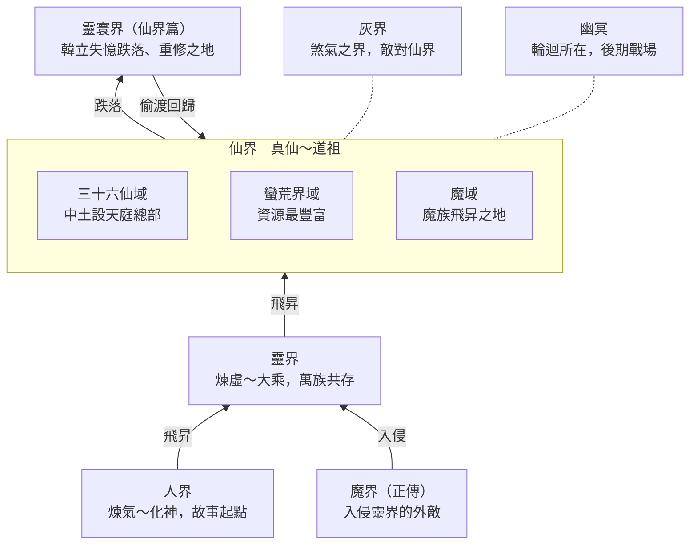

# 《凡人修仙傳》世界觀整理

> [!warning] 參考用，不可照搬
> 這篇是研究筆記，記錄的是忘語作品的專屬設定。自己的遊戲只借用類型概念，名稱、人物、劇情都要重新設計，見 [[避免照搬清單]]。

## 總覽：宇宙界面

整個世界是一座往上爬的塔：人界、靈界、仙界逐層飛昇，每層靈氣更濃、境界上限更高。仙界外圍還有灰界、幽冥等異界，是仙界篇中後期的主要舞台。

韓立在仙界篇開頭被打回下界靈寰界，重新修煉後再偷渡回仙界。

## 修煉境界體系

境界共分兩段：下界八個大境界修「法力」，飛昇仙界後改修「仙靈力」，以打通仙竅的數量作為硬指標，最高是道祖。除了煉氣期，每個境界都再細分為初期、中期、後期、巔峰。

| 階段 | 境界 | 進階門檻 | 壽元與能力 |
| --- | --- | --- | --- |
| 下界 | 煉氣 | 共十三層，靠靈根吸納靈氣 | 約百年；洗髓易經後可築基 |
| 下界 | 築基 | 壓縮氣海靈氣、凝結金丹 | 約兩百年；能用先天真火煉丹煉器 |
| 下界 | 結丹 | 靈液凝固成金丹 | 約五百年；能煉本命法寶、不靠法器飛行 |
| 下界 | 元嬰 | 丹破嬰生 | 約千年；元嬰不滅可奪舍，需避雷劫 |
| 下界 | 化神 | 與天地五行相合 | 約兩千年；能調用天地元氣，可飛昇靈界 |
| 靈界 | 煉虛 | 元嬰轉為虛影，可練身外化身 | 有元氣供應則壽元近乎無盡，但仍有天劫 |
| 靈界 | 合體 | 虛影顯化真身，渡五行劫、真雷劫、心魔劫 | 能初步借用法則之力 |
| 靈界 | 大乘 | 元嬰固化、肉身重鑄 | 能借用法則之力，渡劫後飛昇仙界 |
| 仙界 | 真仙 | 打通 12 / 24 / 36 仙竅分初、中、後期 | 法力轉為仙靈力，領悟法則；面臨前三衰 |
| 仙界 | 金仙 | 累計 60 / 84 / 108 仙竅 | 凝聚法則之絲，能展開靈域；面臨後兩衰 |
| 仙界 | 太乙玉仙 | 累計 192 / 276 / 360 仙竅 | 360 竅時神魂轉為大羅真魂 |
| 仙界 | 大羅 | 累計 840 / 1320 / 1799 仙竅，並斬三屍 | 斬一屍入中期、斬二屍入後期 |
| 仙界 | 道祖 | 斬第三屍成半步道祖，再渡道天大劫合道 | 出手越多，越快被所修大道同化 |

仙界的兩道關卡：

- **天人五衰**：真仙要過軀衰、仙衰、竅衰，金仙再過魂衰、煞衰，五衰都過才能進太乙。
- **斬三屍**：大羅境要依序斬去惡屍、善屍、自我屍。被斬出的三屍可能獨立存活，成為後患或分身。

道祖越強越受限：一出手就加速與大道同化，所以頂層人物多半隱居幕後，出手要付出代價。

## 仙人分類與靈域境界

仙人依「有沒有法則」和「法則從哪來」分成五類，每類就是一條不同的成長路線。

| 類型 | 法則來源 | 特點與代價 |
| --- | --- | --- |
| 偽仙 | 尚未完全轉化仙靈力 | 剛飛昇的過渡狀態，算真仙最低階 |
| 散仙 | 沒有法則 | 數量最多（「十仙九散」）；沒有法則護身，渡劫進階遠比真仙難 |
| 玄仙（力仙） | 不求法則，專修肉身 | 以力破道，靠打通玄竅進階；極少數，比地仙還稀有 |
| 地仙 | 一方信眾的信念之力 | 需特製雕像凝出「地祇化身」，化身可能比本體強；離開轄區法則幾乎失效 |
| 真仙 | 自己領悟的法則 | 正統路線，打通仙竅逐級往上 |

靈域是金仙以上的核心戰力：以自身法則展開一片領域，在內壓制敵人。靈域本身也有四個境界：

1. **普通靈域**：大多數修士停在這一階。
2. **化靈境**：靈域生出「域靈」，戰力不亞於修士本人。
3. **造物境**：能幻化山川河湖，形成小世界。
4. **天人境**：靈域由虛轉實。

## 法則體系

法則是仙界篇的核心資源和爭奪對象：每種法則對應一條大道，每條大道的頂端都可以成就道祖，而同一條大道的道祖之位有限。

- **混沌法則**：一切法則的源頭，天地初開時就已存在的創世法則，比至尊法則更古老。
- **三大至尊法則**：時間、空間、輪迴。其他三千大道都從這三者分化而來，是整部小說爭奪的焦點。
- **五行本源法則**：金、木、水、火、土，對應五位本源道祖。
- **其他已知法則**（部分）：冰、海、潮汐、雷、風、速、氣、禁錮、毀滅、吞噬、煞氣、劇毒、傀儡、幻、靈魂、陰陽、心魔、預言、詛咒、鬼魅、夢、枯榮。

法則在遊戲性上的幾個特點：

- 法則可以封在物品裡：靈草年份夠久會孕出一絲法則，道丹、仙器也能載有法則。
- 不同法則之間會共鳴或相剋，例如韓立的時間法則和輪迴法則在仙府中產生共鳴。
- 修煉時間法則的人會被天庭追殺，因為時間道祖不容競爭者。

## 地理

正傳的舞台從人界一路升到靈界，仙界篇則在仙界「三十六大仙域」和周邊異界之間展開。下表依主角抵達的順序排列。

| 界面 | 區域 | 設定重點 |
| --- | --- | --- |
| 人界 | 天南、亂星海、大晉等 | 靈氣稀薄的起點，化神是上限，小宗門林立 |
| 靈界 | 人族與妖族地盤、萬族共存 | 煉虛到大乘的舞台；對外要抵禦魔界入侵 |
| 靈寰界 | 冷焰宗所在 | 仙界篇開頭：韓立重傷失憶後跌落的下界 |
| 仙界 | 中土仙域 | 三十六仙域中最大，九州四海，天庭總部在中心天宮大陸 |
| 仙界 | 北寒仙域 | 韓立飛昇處；含黑風海域、荒瀾大陸、古雲大陸（燭龍道） |
| 仙界 | 黑土、黑山等四盟仙區 | 真言門遺跡所在；結局韓立隱居於黑土仙域 |
| 仙界 | 大金源仙域 | 九元觀、百造山等大勢力所在 |
| 仙界 | 蠻荒界域 | 無邊的原始區域，資源最豐富；仙域是從其中開闢出來的 |
| 仙界 | 魔域 | 仙界中的獨立地區，魔族飛昇之處，聖城為夜陽城 |
| 灰界 | 九幽域、黑繩域、輪迴域等 | 萬物皆灰、以煞氣為主、三日六月；與仙界敵對 |
| 幽冥 | 幽冥鬼域、閻羅之府 | 輪迴所在，後期戰場 |

灰界的三大勢力按政治立場分：九幽域保守、黑繩域中立、輪迴域激進，主張入侵仙界。灰界對修士的威脅是煞氣侵蝕，要靠「洗煞池」清除。

## 勢力

仙界的主軸是天庭對輪迴殿：一方是掌控秩序的官方，一方是布滿暗線的反抗者，其餘宗門、種族、商會在兩者之間選邊或自保。

| 類別 | 勢力 | 定位 |
| --- | --- | --- |
| 官方 | 天庭 | 仙界最大管理機構，各仙域設仙宮（管秩序）與仙獄（管刑案）；由時間道祖古或今為首的「天道七君」掌權 |
| 反抗 | 輪迴殿 | 對抗天庭，與灰界合作；旗下有暗殺組織十方樓、交易組織無常盟、易容組織易袍會 |
| 宗門 | 燭龍道 | 北寒仙域大宗，十三位金仙道主，藏有時間功法 |
| 宗門 | 真言門 | 昔日黑土仙域第一宗，時間功法的源頭，被時間道祖滅門 |
| 宗門 | 九元觀 | 九元道祖（金之本源）所創 |
| 宗門 | 百造山 | 仙界頂尖的煉器宗門 |
| 宗門 | 補天宗 | 中土仙域的天機占卜大宗 |
| 商會 | 廣源齋 | 魔域第一商會，在各仙域有暗中聯繫 |
| 王朝 | 夜陽王朝 | 魔主統治魔域的政權 |
| 種族 | 蠻荒聖殿 | 蠻荒八大真靈王結束戰亂後成立的聯盟；下轄天狐、雷鵬、搬山猿等血脈部族 |
| 種族 | 灰界虛合族、九幽族 | 灰界的貴族與天才種族 |

## 資源與經濟

修仙經濟圍繞「年份」運作：靈藥越老越值錢，而主角的掛「掌天瓶」正好能催熟靈藥，這是整部小說的經濟引擎。

**貨幣**：下界用靈石，仙界用仙元石。仙元石同時是修煉耗材，傀儡螃蟹道人每次出手也要用它。

**丹師階級**

| 等級 | 能煉什麼 |
| --- | --- |
| 人丹師 | 一般修士用的丹藥 |
| 地丹師 | 仙人用的丹藥 |
| 天丹師（道丹師） | 道丹，即蘊含法則之力的丹藥；地位最高 |

**丹藥的功能分類**：精進修為（依境界分階）、突破瓶頸（如助金仙渡第五衰的太乙丹）、抵禦煞氣、領悟法則（道丹）、禁藥（燃燒元嬰精血暫時強化）。高階丹藥會引來丹劫。

**靈材年份**：靈草依年份變色或長出金紋，年份夠久會孕出一絲法則。年份就是天然的品質等級。

**法寶品階**

- 下界：法器 → 法寶 → 本命法寶 → 靈寶。
- 仙界：仙器分「不入品」和九品到一品，一品最高；三品已是宗門鎮派之寶的等級。最頂端是「道器」，如能影響眾生轉世的六道輪迴盤。
- 仙器可按法則分類，也有專攻神魂的神魂仙器。

**功法**：按法則屬性和路線分（地仙功法、玄仙煉體功法、時間功法等）。真言門的鎮派絕學分成五部時間功法，散落在不同宗門，是主角一路收集的目標。

## 真靈與靈獸

真靈是天生掌握法則的上古神獸，血脈可以被繼承、收集、融合；蠻荒界域的政治秩序也按真靈血脈分層。

- **蠻荒八大真靈王**：白澤、遊天鯤鵬、九尾仙狐、山岳巨猿、羅睺、檮杌、朱厭、墨眼貔貅。各自的直系或族裔部族構成蠻荒勢力。
- **常見真靈**：真龍、天鳳、麒麟、玄武、青鸞、雷鵬、螣蛇、夢魘、五色孔雀等。
- **血脈系統**：韓立的「驚蟄訣」可融合十二種真靈血脈並幻化成真靈；魔域的煉體功法也靠煉化真靈血脈打通玄竅。
- **靈寵路線**：主角的靈寵會和主角一起成長，甚至覺醒前世。例如噬金蟲金童後來恢復道祖修為，小白繼承了父親墨眼貔貅的傳承。

## 核心衝突與主線脈絡

正傳的衝突是「凡人要活下去」，仙界篇升級為「法則之位的爭奪」：韓立修煉時間法則，而時間道祖古或今不容競爭者，所以天庭一路追殺。

正傳（2,446 章，十一卷）：山村少年進入江湖小門派，靠神秘小綠瓶催熟靈藥，從人界一路修到靈界大乘，經歷魔界入侵，最後飛昇仙界。

仙界篇（1,394 章，五卷）：

| 卷 | 章數 | 主線 | 韓立境界變化 |
| --- | --- | --- | --- |
| 一、風起靈寰 | 80 | 飛昇後遭伏擊，元嬰被封、失憶三百年，跌入下界重修煉體，再偷渡回仙界 | 從法力盡失重新起步 |
| 二、重回仙界 | 432 | 做地仙、破封印、入燭龍道取得時間功法，領悟時間法則，探冥寒仙府 | 真仙 → 金仙中期 |
| 三、時空迷蹤 | 487 | 躲避天庭通緝，轉戰蠻荒、灰界、魔域，揭開真言門滅門之謎 | 金仙 → 太乙 |
| 四、大羅之爭 | 243 | 穿越回真言門全盛期拜師，獲得加速時間的大陣，閉關十萬年 | 太乙 → 大羅 |
| 五、大道歸一 | 151 | 斬三屍，輪迴殿與天庭大戰，聯手斬殺時間道祖 | 大羅 → 道祖，最後自跌至大羅巔峰 |

關鍵伏筆：輪迴殿主是「另一個韓立」。他曾在時間線上敗給古或今，靠掌天瓶回到更早的時間點，把押注放在主角身上。時間旅行、前世記憶、因果是仙界篇反覆使用的敘事工具。

結局：韓立成為時間道祖後，為避免被天道同化，用掌天瓶吸納道祖本源，瓶碎、修為跌回大羅巔峰，選擇自由而非至尊之位。

## 好玩的機制在書中的樣子

以下例子取自原文，都是書中專屬的寫法；通用版本見各概念筆記。

- **洞天之寶**（[[洞天與空間法寶]]）：正傳中有一族守護的「山海珠」，被稱為罕見的洞天之寶，屬空間至寶，被前人用秘術封印在寒潭。仙界篇韓立擁有「花枝洞天」，在裡面開藥園、讓靈寵閉關，並利用它隔絕感知，把貴重法寶藏進去。敵人也會用洞天之寶當戰場，例如魔道鎮宗秘寶「赤血天鬼幡」，內部是一片血海。
- **秘境**（[[秘境]]）：「血色禁地」是宗門弟子幾乎必死的試煉，只產築基丹需要的靈藥，修為受限，弟子之間互相廝殺奪寶。仙界篇的冥寒仙府、太歲仙府等仙府秘境是主線舞台。
- **遮掩氣息**（[[隱匿與追蹤]]）：韓立早期在眾多法術中挑了「斂氣術」，因為它能對抗偵查用的「天眼術」，只要不被肉眼看見就能完全收斂氣息；這門中階法術他苦練半年才學會。韓立的謹慎很大一部分就體現在隱匿手段上。
- **神識追蹤**（[[神識]]）：書中常見高手用神識範圍追人、主角用斂息脫離範圍的攻防，例如追兵發現韓立消失後，把神識範圍擴大一倍才又找到他。
- **遁術**：書中有專門的身法與遁術，例如「羅煙步」「血遁」，是逃命的關鍵手段。
- **地圖**（[[地圖與探索]]）：韓立進陌生地區前，會向當地村人打聽，自己動手繪出詳細地圖；也有用古鏡顯現巨型地圖、標出目標光點的情節。
- **丹方**（[[煉丹與丹方]]）：丹方是師兄、師伯「珍若性命」的私藏，韓立用稀有靈草去交換適合自己的丹方。築基丹的改良丹方用五級妖獸妖丹，取代只有血色禁地才採得到的靈藥。
- **拍賣會與地下拍賣會**（[[拍賣會與交易]]）：正傳中地下拍賣會常有以物易物，韓立在那裡見過通天靈寶的仿製品；仙界篇也有地下拍賣會，參加者至少是真仙中期。
- **侍妾與從屬**（[[從屬與手下]]）：書中坊市有買賣爐鼎、侍妾的描寫，也有女修主動提出當侍妾換取庇護。另外常見心魔之誓、血契作為交易與控制的保證。
- **魂牌**（[[分魂與化身]]）：仙界篇中宗門以修士的一縷分魂加一份精血煉製魂牌，用來確認弟子生死。
- **分魂降臨**（[[分魂與化身]]）：正傳中有靈界大能以一縷分魂降臨下界，目的是替本體萬年後的大劫留後手。仙界篇韓立的神魂穿越回過去，附身凌雲子並留下因果。
- **靈寵**（[[靈寵]]）：
    - **奇蟲榜**：書中有一份天下奇蟲排行，附習性記載。噬金蟲排第十二，被描述為群聚的兇蟲，愛吃其他奇蟲，能吞五金與天地靈氣，水火不侵；血玉蜘蛛排在一百多名，但能吐絲剋制噬金蟲。
    - **噬金蟲**：韓立用育蟲心得大量培育，蟲群互相吞噬繁殖，後代一代比一代強，外殼從銀色逐漸轉成金色才算升階。仙界篇揭露其蟲王「金童」是噬金蟲族前世的共主，最終恢復道祖修為。
    - **餵養取捨**：同樣餵飼靈丸，數量少的血玉蜘蛛長得明顯，幾百隻噬金蟲平分後效果微乎其微。
    - **六翼霜蚣**：奇蟲榜第十八，和噬金蟲同為蠻荒上古靈蟲，據說帶有冰屬性真龍血統；成熟體通體雪白、背生六翼，寒氣能覆蓋百里、冰凍萬物。韓立遇到的是御靈宗女修飼養的幼蟲。因為靈蟲有「主人死亡就自爆」的禁制，韓立為了得到蟲卵沒有殺她，後來這名女修拜韓立為師，獻上霜蚣與驅蟲秘術。霜蚣的寒氣能加速煉化他體內的乾藍冰焰，兩者融合出比乾藍冰焰更強的紫色魔焰，成為當時的殺手鐧；之後霜蚣在蟲室中開始產卵繁殖。
    - **啼魂獸**：外形像小猴，能「吸魂啖鬼」，噴出黃色霞光吞掉鬼火，在鬼霧中替韓立開路。仙界篇揭露牠是冥王轉世。
    - **銀月**：寄居在古寶中的器靈，記憶不全，記得自己屬於銀月狼族；能在特定條件下奪舍，也能暫時充當韓立飛劍的器靈，讓本命法寶威力大增。
    - **雷鵬骸骨**：化形末期雷鵬的骨翅仍含雷電之力，後來被煉成飛行用的翅膀法寶。
    - **化形規則**：書中說大部分獸類到八級妖獸時渡雷劫，化為人形並完全開啟靈智；變異或血脈特殊的獸類化形較晚或終生無法化形，但進階後更強。韓立收服的豹麟獸靠他長期供應丹藥，修到十級妖獸巔峰，再一步就是化神級。亂星海的化形妖修自稱「化形期第二階段」，並指出「九級」是人類的劃分，也不滿人類把化形妖修當低階妖獸看待。
    - **從靈寵到修士**：仙界篇中，啼魂已是以人形行動的女修，會吞噬鬼王後恢復人形、在花枝空間閉關修煉，後來進階大羅，覺得自己拖累韓立而獨自去閉關苦修；小白能在貔貅原形與人形之間切換；金童恢復記憶後離開韓立，去追回自己的道祖修為；韓立用時間差空間幫小白、精炎童子加速修煉。
    - **仙界篇**：墨眼貔貅幼獸「小白」認韓立為主，後繼承父親的傳承；黃金螃蟹傀儡「蟹道人」原來是魔域魔君。
- **精血**（[[精血與煉化]]）：
    - 韓立用精血對血玉蜘蛛下控神禁制，孵出的小蜘蛛把他當成父母般親近。
    - 有女修用自己精血種下「困心術」，配合禁制令牌，在百里之內能操控對方的簡單動作，但驅動不了對方法力。被控制的一方說明：因為雙方修為相差不大，控制只限簡單動作，只要摧毀那塊令牌就能脫身。
    - 失去主人的神識控制後，靈蟲會自動飛回靈獸袋。
    - 城市發給長住修士的身分指環，要滴入精血才能認主，別人搶去也沒用。
    - 上古修士以全身精血封印石門，血氣魔性極濃。
    - 外海狻猊王族的老狻猊不惜消耗精血發動「萬妖令」，率數萬妖獸踏平人類島嶼。
    - 「血影遁」能一口氣逃走，但精血大損，事後要閉關苦修幾年。
    - 仙界篇韓立以精血在青銅大缸中施法，感應失散的法寶與靈寵方位；追殺者想憑一滴精血在仙界找人，被前輩斥為荒唐，因為仙界太大。也有人用秘術造出「精血假身」誘敵。
    - 真靈精血是血脈的關鍵，也被當作開啟真靈之穴的鑰匙。
- **魂牌與令牌**（[[魂牌與令牌]]）：
    - 碎魂門門主看到弟子的本命牌靈光熄滅，立刻派其他弟子去生擒兇手。
    - 昆吾山的銀翅夜叉與圭姓妖修，本命牌被扣在昆吾殿中，即使出了困靈陣也離不開昆吾山一步，必須取回本命牌才能自由。
    - 天淵城的高層靠本命牌確認某位合體期修士隕落；但韓立沒在天淵城留下本命之物，他們就無法判斷他的生死。
    - 仙界篇中，宗門長老的魂牌碎裂後，執法殿上門追究是誰派他去截殺的；另一宗門兩位太上大長老魂牌接連碎裂，眾人不敢相信，因為魂牌以分魂加精血煉成，數萬年來從未出錯。
    - 「元魂燈」是能盛放、壯大分魂的奇寶。
    - 令牌：藥園與洞府都用禁制令牌開關，租來的洞府令牌百年後收回；廣寒令是進入廣寒界的鑰匙，一枚可多帶幾人入場，引來各族拉攏持令人；逆星盟對持有虛天鼎者的追殺令多年未撤；仙界篇宗門發給新任長老「執事長老令」與轄地。
- **控制手段**（[[控制手段]]）：
    - **屍蟲丸**：正傳開頭，墨大夫逼韓立服下「屍蟲丸」，其實是秘法泡製的蟲卵，潛伏一年；一年內服下解藥就會消融，否則蟲卵孵化，把體內臟器活生生吃掉。韓立一面想辦法自救，一面盤算拿修煉進度要挾對方交出解藥。
    - **黑劫蟲**：仙界篇積鱗空境青羊城的獨門秘蟲，是一條盤踞在心臟上的黑色蜈蚣；被控者只要逃跑或試圖驅除，牠就會咬碎心臟。
    - **幽魂蟲**：灰界九幽族的特有神通，抽取他人魂魄之力，以本命神通祭煉成蟲，從眉心打入對方神魂，反客為主地控制行動、身體甚至念頭。用幽魂蟲煉成的傀儡最高階：意識仍在，能力與法則都保留，卻連自殺都辦不到。韓立一行被擒時，腦中另有禁制封住神魂與神識，元嬰被黑色雷絲禁錮在丹田；同囚的人勸他們趁還沒被植蟲前自決。
    - **封印元嬰**：仙界篇開頭，韓立的元嬰被人以鎖鏈封住，法力盡失，只能靠煉體重新起步。
- **煉化**（[[精血與煉化]]）：煉化乾藍冰焰要一絲一年，全部煉完需兩百多年，六翼霜蚣的寒氣能大幅縮短時間。反派鬼靈門則提議以陰火大陣煉化活人肉身、只留魂魄來血祭修煉邪功。
- **道侶**（[[道侶]]）：修仙家族會廣邀各國修士為族中女子挑選雙修道侶；也有師長安排弟子結為道侶、新婚道侶早逝成為未亡人等情節，反映道侶在修仙社會中的政治與現實面。

## 煉丹（[[煉丹與丹方]]）
- **掌天瓶催熟**：正傳中，掌天瓶每隔幾天凝出一滴綠液，滴在靈草上就能讓年份暴增；直接滴比稀釋效果好，綠液離瓶後一刻鐘內不用就會消散，但可以反覆滴同一株靈草疊加年份。韓立因此不再為藥材發愁，這是他早期煉丹的根本。
- **精炎小人煉丹**：仙界篇中，精炎火鳥化為精炎小人，坐在銀色丹爐下掐訣，把身上的白焰分成十二道，均勻包住爐底；韓立只需專心投藥、打法訣，並用時間法則平衡材料。煉虛元丹一爐就要七八年，他斷斷續續煉完全部材料，除去失敗的，得到二十幾枚。韓立也覺得這麼珍稀的火鳥只拿來煉丹，實在有點委屈牠。
- **冥寒仙府奪太乙丹**：仙府大殿中有一座翠綠古丹爐，爐下燒著能把金仙燒成虛無的白色火焰，定時出丹並引來銀色丹劫，眾人一出丹就搶。某次爐底白焰突然暴漲十倍，下一爐丹片刻就煉成，眾人以為是爐火大盛加速凝丹（但也有爆丹風險）。等韓立把整座丹爐拔走時，精炎小人從爐中飛出，體型變大、氣息強了數倍，還吐出一枚帶有三足金烏銀紋、比其他太乙丹更強的太乙丹，可見牠一直潛伏在爐內。
- **丹師三階與道丹**：魔光向韓立解釋，仙界煉丹師分人、地、天三階；天丹師又稱道丹師，以能否煉出蘊含法則之力的「道丹」為準。道丹表面有道紋，最多九道。吃道丹也只有極低機率悟出法則。千名人丹師約出一名地丹師，十萬名地丹師未必出一名道丹師。道丹丹方多在大勢力手中，還傳說同一張道丹丹方只能被一定數量的人領悟。

## 五行生洩的實戰（[[五行]]）

- **金屬獸**：仙界篇金源仙域的一種異獸，全身由至真至純的金屬性元氣凝聚而成，在金氣濃厚的金源山脈裡如魚得水；牠們會啃食受火力侵染的金礦，因此連精炎火鳥的銀焰都能吞下，兩隻還能融合成一隻更強的。
- **水靈域驅散金屬獸**：藍元子在「金之力場」中展開水屬性靈域，靈域看似沒有殺傷力，卻逼得金屬獸紛紛遠離。他解釋：金能生水，所以在金之力場中，他的水屬性靈域天然強上三分；金屬獸若留在靈域內，就會被吸取自身的金屬性之力，因此避之不及。他據此自認佔盡地利、立於不敗之地。
- **境界壓過地利**：韓立不用仙靈力，只憑肉身之力就正面衝撞過去，說明境界差距夠大時，五行地利也不管用。

## 神魂神通（[[神魂神通]]）

- **大衍訣**：千竹教開派祖師獨創，專門強大神識、修煉分神之術，是該教操縱傀儡的必修功法；修成第三層的弟子能同時驅使兩百多具傀儡。創立者大衍神君因天地靈氣衰竭，元神最後附在傀儡上。
- **驚神刺與失神刺**：「驚神刺」是大衍訣的神識攻擊神通。韓立沒練到大衍訣最後幾層，就參照它自創簡化版「失神刺」，起名以示區別；面對古魔時突然一擊，對方動作一滯，頭顱隨即被斬落，但韓立也臉色發白、精神萎靡。
- **煉神術**：仙界篇的仙界秘術，能讓神識暴漲。韓立用它把神識凝成巨斧、巨手去拉扯封住元嬰的鎖鏈，強行以神念侵入元嬰時還遭到反噬。他也見識過有人以煉神術一聲低喝，讓釋放靈域的人神識崩潰，形容是「加強版的驚神刺，威力放大百倍」。
    - **禁術與層數**：煉神術能大幅增強神識，但修煉者大多會瘋魔嗜殺、為禍蒼生，所以被各大仙域所不容，各仙宮嚴禁修煉。功法共七層，前三層早已流傳在外；輪迴殿的「地榜」上可用貢獻點兌換各層口訣，第四層要兩千點、第五層要一萬點，新加入者可免費得一層。韓立最初是在靈界從一位仙人那裡得到上半部，自己摸索練到第三層，讓輪迴殿的蛟三大為驚訝。第五層艱深晦澀，他苦修數百年仍進展有限。
    - **神念之鏈**：銀白、晶瑩、若隱若現的鎖鏈，並非實體。韓立用它纏住失控的女修再加以封印，也用它禁錮一名金仙的元嬰，對方一眼認出這是禁術才有的神通。在灰界被植入幽魂蟲時，他的神魂小人放出神念之鏈纏住幽魂蟲，但幽魂蟲化成黑霧掙脫；他也曾讓神念鎖鏈交織成大網，硬扛一股無形的神魂衝擊，衝擊順著鏈網傳回識海，震得他站不穩。
    - **神念囚籠**：煉神術第四層修成後才能施展的秘術，以神念之鏈交織成籠，禁錮敵人神魂，暫時剝奪其神魂與身體的聯繫。韓立偷襲一頭毫無防備的太乙境樹妖，一舉成功；但只施展片刻，神識就只剩三成，至少要一個月才能恢復。
    - **神念小劍（念劍訣）**：一柄寸許長的半透明晶光小劍，從眉心射出。照骨真人以指尖直刺而來時，小劍沒入他的指尖，瞬間出現在他的識海中，化成巨大劍鋒斬落。韓立在灰界被黑色波紋禁制封住神魂時，用念劍訣斬出一道小裂縫，把一縷神念送進花枝空間，通知蟹道人出事了。另有一次，他醒來時神念小劍正懸停在同伴石穿空眉心前，戒備著周遭。
- **神魂攻擊剋肉身強者**：噬金蟲肉身堅硬、幾乎吞噬一切攻擊，弱點正是神魂；有一族之王就是用神魂攻擊把蟲靈驚退的。
- **瞳術**：「天眼術」是偵查法術，斂氣術能對抗它；「明清靈目」是韓立用明清靈水多次擦拭雙目練成，能看穿神識穿透不了的風沙；「真實之眼」附在真言化輪經第二重，能看穿幻虛，但要真言寶輪凝出十二團道紋才能修煉。書中另有九幽魔瞳、玄陰之眼、修羅鬼眼等瞳術。
- **夢引術**：玄陰經上的秘功，能封印、篡改他人記憶；除非修為遠在施術者之上的人親自解術，否則無解。韓立用它抹去一名婦人見過他的記憶，讓她只以為遇到一位大方的前輩，既保護自己，也免得她招來殺身之禍。效果遠勝「控神術」和無憂針、忘塵丹這類手段。
- **曲魂分身 vs 第二元嬰**：韓立早期的曲魂分身只是元神分出的一絲神念，沒有記憶情感與自主能力，像高階傀儡，離韓立太遠就會失去行動能力。後來修成的第二元嬰則擁有兩個完全獨立、記憶情感相同的元嬰；主嬰出事時第二元嬰能慢慢轉為主嬰，融合合適的修士軀體後可成為化身，本體消散也能存活。

## 火與冰（[[異火與冰火]]）

- **精炎火鳥燒冰**：仙界篇中，藍氏兄妹以冰屬性靈域催出「玄冰斬元劍」，精炎火鳥（頭生七色彩焰的銀焰火鳥）一頭撞上，藍色寒光與熾烈火焰交融，激起大片白霧；火鳥再一衝，把劍逼回符紋，靈域光幕也開始不穩。在寒氣陣中，韓立也讓精炎火鳥在體內固守要害，防止寒氣侵擾。
- **冰鏡映不出火**：被妙法仙尊困在六面冰鏡中時，韓立發現以冰屬性法則凝成的幻鏡只映出自己，映不出精炎火鳥，判斷這幻鏡無法幻化火屬性的影像，於是讓火鳥化成「火鑽」從指尖鑽入鏡面破陣。
- **乾藍冰焰**：藍色的火焰形態，散發的卻是刺骨奇寒，被稱為至陰至寒之火；被燒到一點，連元嬰都會被煉化，傳說並非此界之物。反派玄骨想把它融合成更強的「修羅聖火」，但只敢先融合一小半，以降低秘術反噬的風險；辟邪神雷能擋住冰焰寒氣，兩者一度僵持。
- **冰火融合出新火**：韓立用六翼霜蚣的寒氣加速煉化乾藍冰焰，兩者融合出比冰焰更強的紫色魔焰。
- **火靈一火多用**：精炎火鳥平時化為精炎小人，分成十二道火焰包住丹爐替韓立煉丹；牠被金屬獸吞掉部分火焰後，又在五彩火池吃下七彩火丹砂，威力還能再升一籌。

## 魔界：不是純粹的壞蛋（[[陣營與動機]]）

魔界入侵靈界看似兇殘，但原文一步步揭露了它的動機與內部複雜性：

- **天災級威脅**：上古時一隻「螟蟲之母」帶著子孫接連吞噬數個界面，兩名真仙本體降臨，把牠引到魔界大戰，斬盡其子孫後將重創的牠封印在魔界。如今的魔界大劫，正和牠的甦醒有關。
- **入侵的真正目的**：這一次魔族一反常態，要長期佔領靈界，並拼命魔化佔領的土地。靈界高層推斷，魔族是在為將來的退路做準備，想在靈界開闢適合自己生存的地盤；但魔族三大始祖並沒有放棄鎮壓螟蟲之母，佔地只是萬一的手段。
- **不是全族的意志**：韓立潛入魔界後發現，一般魔族根本不知道入侵的事，參與的只有聖祖的直屬勢力和被控制的魔獸。
- **對凡人留手**：魔族精銳攻下人族據點後，把俘虜的修士以魔氣灌體轉化成魔人，卻沒有屠殺普通百姓。
- **可以交易、可以談**：韓立和魔界始祖寶花談交易，對方提出合作，他要求先拿出可信的證據才肯冒險相助；另一位聖祖元魘被韓立的實力震懾後，也改用交易的方式來換他手上的靈草。
- **魔族內部的權謀**：藍瀑聖祖與六極的化身聯手設下上古奇陣，伏擊元氣大傷的寶花。
- **不同的價值觀**：魔族戰士直言只要能擊殺敵人，用什麼手段都一樣，嘲笑人族講究的那一套很虛偽。
- **修煉環境不同**：魔界天上掛著三個血紅太陽，靈氣比靈界稀少得多，空中飄著魔氣；韓立需要魔甲、魔氣，並完全收斂人族氣息，才能偽裝成魔族在魔界行動。
- **仙界篇的延續**：魔域皇子石穿空成為韓立的同伴；魔君石空解就是韓立的傀儡蟹道人；魔域之主與韓立、輪迴殿主聯手對抗時間道祖古或今，但戰後又因野心與韓立反目。

## 做遊戲時可借鑑的設計要點

這個世界觀最值得學的是「每一層都有可量化的門檻和狠的代價」，很容易轉成遊戲系統。

- **可數的進度**：仙竅數量就是現成的經驗條和天賦樹節點。
- **關卡式突破**：天人五衰、丹劫、斬三屍、道天大劫可以做成 Boss 戰或幽靈關卡，且需要對應的丹藥、靈材準備。
- **多條成長路線**：真仙（法則）、玄仙（肉身）、地仙（信眾）適合做職業或流派，地仙的「離開轄區就變弱」是好的取捨。
- **法則作為元素系統**：五行加特殊法則、共鳴與相剋，可用來做技能搭配或機率加成。
- **年份即品質**：靈藥按年份變色、會「催熟」的核心道具，是放置類、種田類玩法的天然引擎。
- **隱藏決定**：道祖不能隨意出手，可以解釋「為什麼最強的人不自己解決問題」。

相關的通用概念：[[修煉境界]]、[[仙人分類]]、[[法則與大道]]、[[天劫與心魔]]、[[修仙資源]]

## 來源

- [《凡人修仙之仙界篇》百度百科](https://baike.baidu.com/item/%E5%87%A1%E4%BA%BA%E4%BF%AE%E4%BB%99%E4%B9%8B%E4%BB%99%E7%95%8C%E7%AF%87/22187879)（2026-11-02 查閱）
- 使用者提供的《凡人修仙傳》及《仙界篇》全本文字檔（卷名、章數）
