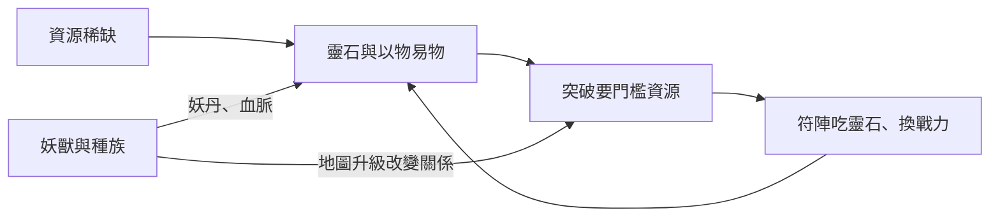

# 《凡人修仙傳》的經濟、修煉、符陣與種族設計

> [!warning] 參考用，不可照搬
> 這篇是研究筆記，記錄忘語作品的專屬設定。自己的遊戲只借用「做法」，名稱、人物、具體設定組合都要重新設計，見 [[避免照搬清單]]。

> [!note] 這篇和其他筆記的分工
> 具名丹藥、法寶的逐條清單已經在 [[丹藥圖鑑]]、[[武器法寶]]；類型通用的說法在 `概念/` 各篇。這篇只回答一個問題：**凡人在這四塊是怎麼設計的、為什麼這樣設計**。每項用 5W 拆（Who 誰、What 是什麼、When 故事哪個階段、Where 在哪、Why 作者為什麼需要它，必要時加 How）。標 `（待查證）` 的細節，之後可用全本文字檔核對。

---

## 一、經濟與社會

### 1. 靈石：貨幣、燃料、修煉材料三合一

| 問 | 答 |
| --- | --- |
| Who | 所有修士；宗門與家族控制礦脈 |
| What | 原文說靈石依靈力多少分低階、中階、高階、超階四等，又依屬性分金、木、水、火、土五行靈石，另有風、雷等稀有靈石（第一百三十一章〈靈石與靈符〉；後文也常見「頂階靈石」）。靈石同時是交易貨幣、陣法與傀儡的能源、修煉時補充靈氣的耗材。到了仙界換成仙元石，邏輯不變（蟹道人每次出手都要耗仙元石） |
| When | 從煉氣期一路用到仙界 |
| Where | 坊市、宗門、礦脈；亂星海的散修尤其依賴 |
| Why | 一種東西扛三種用途，就逼主角做取捨：靈石拿去買東西，就沒得修煉、沒得開陣。貨幣和戰力綁在一起，「窮」才會真的危險 |
| How | 書中很少寫精確物價，但常寫「這東西值幾萬靈石」「洞府租金」，讓讀者用靈石感受每件物品的分量 |

### 2. 以物易物比靈石更重要

| 問 | 答 |
| --- | --- |
| Who | 韓立與各路商鋪、前輩、同道 |
| What | 真正珍貴的東西（丹方、高年份靈草、古寶）靈石買不到，只能用同等稀有的東西換。韓立在萬寶樓用物件交換法器、用千年靈草換符寶，都是這個邏輯（見 [[武器法寶]]） |
| When | 全書，越往後越明顯 |
| Where | 商鋪的私下交易、地下拍賣會、修士之間 |
| Why | 這讓掌天瓶的價值放大：韓立最缺的是錢，但他能「印出」最硬的通貨：高年份靈草。外掛就這樣接進經濟系統，而且每次拿出來都有曝光風險 |
| How | 交易場面常寫雙方試探底價、隱瞞來源，韓立會分散出售、改變外貌，避免被盯上 |

### 3. 坊市、小會與拍賣會的分層

| 層級 | 書中的樣子 | 誰在用 | 設計用意 |
| --- | --- | --- | --- |
| 宗門內 | 用貢獻、任務換資源，藥園由弟子打理 | 宗門弟子 | 宗門是一台把弟子勞力換成資源的機器 |
| 坊市、商鋪 | 萬寶樓這類固定店鋪 | 低中階修士 | 日常補給，價格相對透明 |
| 散修小會 | 太南小會：岚州太南谷五年一次、專給低階修士的交易會，常和升仙大會同期（第一百二十八章〈太南小會〉）。韓立在這裡第一次見識修仙界的物價：一張初級下階符籙一到兩塊低階靈石，《長春功》只值兩塊低階靈石 | 散修 | 沒有宗門的人也有市場，但治安差 |
| 拍賣會 | 公開競價，壓軸物引來各方 | 中高階修士、大勢力 | 製造「大家都想要同一樣東西」的衝突場 |
| 地下拍賣會 | 以物易物、參加者有修為門檻 | 高階修士 | 禁物、贓物流通，劇情鉤子最多 |

Why：每一層都同時是**交易場**和**危險場**。交易結束後的跟蹤、截殺幾乎成了固定橋段，所以「買到東西」和「活著帶走」是兩件事。詳見 [[拍賣會與交易]]。

### 4. 宗門經濟：弟子是勞力，也是投資

| 問 | 答 |
| --- | --- |
| Who | 黃楓谷等宗門、宗門弟子、長老 |
| What | 宗門提供功法、庇護、丹藥配額；弟子付出勞動（如韓立管藥園）、參加試煉（血色禁地）、戰時出征 |
| When | 韓立在黃楓谷的時期最完整 |
| Where | 越國七派 |
| Why | 宗門不是慈善機構。作者讓宗門用「投資報酬」的眼光看弟子：資質好的給資源，資質差的去做雜役，試煉死了也不心疼。這和韓立「不把命交給組織」的性格互相印證 |
| How | 師父收徒看資質、看能不能築基；宗門遇到戰爭會遷徙、會犧牲外圍弟子 |

### 5. 修仙家族

| 問 | 答 |
| --- | --- |
| Who | 依附宗門或割據一方的修仙家族 |
| What | 靠血緣傳承靈根、功法、資源；用聯姻、選道侶擴張勢力（見 [[道侶]]） |
| When | 人界各階段都有，靈界也有真靈世家 |
| Where | 越國、天南、亂星海、靈界 |
| Why | 家族是「小一號的宗門」，但多了血緣：資源偏給嫡系、族人背叛的代價更重，適合寫家族內鬥與託孤 |
| How | 韓立常以外人身分捲進家族的危機（求援、聯姻、繼承），用完就走 |

### 6. 仙凡關係

| 問 | 答 |
| --- | --- |
| Who | 凡人百姓、江湖門派、王朝、修士 |
| What | 修士和凡人基本上是兩個世界。凡人眼中的修士是神仙；修士眼中的凡人大多無關緊要，但魔道會拿凡人煉魂、血祭（見既有筆記的鬼靈門陰火大陣） |
| When | 第一卷最集中，之後偶爾回頭 |
| Where | 越國江湖（七玄門、野狼幫）、凡俗城鎮 |
| Why | 作者用凡人當**時間的刻度**：韓立每次回到凡間，親友都老了、死了。仙凡之隔不只是力量差，更是壽命差 |
| How | 韓立對凡人多半保持距離，但會照顧欠過恩的凡人（墨府、厲飛雨），也會用夢引術抹掉凡人的記憶保護對方（見既有筆記） |

### 經濟與社會的設計邏輯

- **稀缺是第一原則**：靈石不夠用、好東西買不到、名額有限，所有交易都帶著搶的意味。
- **外掛接進經濟**：掌天瓶產出的是全書最硬的通貨，但每次變現都有風險，經濟玩法和隱匿玩法綁在一起。
- **交易即風險**：市場越高級，交易後越危險。
- **組織用投資眼光看人**：宗門、家族對成員都有算計，真心的關係才顯得稀少。

---

## 二、修煉系統的細節

### 1. 境界與壽元（補充既有筆記）

既有的 [[凡人修仙傳]] 已列出境界表。這裡只補設計上的觀察：

| 問 | 答 |
| --- | --- |
| What | 每個大境界都有壽元上限，而且越往上，突破越難、所需資源越多 |
| Why | 壽元把「修煉」變成「和時間賽跑」。卡在瓶頸的長老會為延壽不擇手段，這給了大量配角動機 |
| How | 書中常見坐化的前輩、留下遺府的古修，都是壽元耗盡的結果，也成為主角的機緣來源 |

### 2. 突破要靠「門檻資源」

| 境界門檻 | 書中的門檻資源 | 設計用意 |
| --- | --- | --- |
| 煉氣 → 築基 | 築基丹（主藥只在血色禁地） | 第一次讓主角為資源拚命 |
| 築基 → 結丹 | 結丹輔助丹藥，如亂星海大名鼎鼎的降塵丹，能「有一定幾率」提高結丹成功率；六連殿以它當報酬招募假丹修士（第三百七十七章〈丹方與妖丹〉） | 名額更少，宗門只給核心弟子 |
| 結丹 → 元嬰 | 結嬰靈物、丹藥 | 人界頂端的資源爭奪 |
| 化神以上 | 人界靈氣衰竭，幾乎無路 | 逼主角離開人界 |
| 靈界、仙界 | 天劫、五衰、法則 | 門檻從「物」變成「悟」 |

Why：每個門檻都綁一種**有限資源**，資源有限就有競爭，有競爭就有劇情。主角有掌天瓶，等於在每個門檻都多了一點機會，但也只是機會。

### 3. 功法：有上限、會斷層、可以拼

| 問 | 答 |
| --- | --- |
| Who | 韓立與各宗門 |
| What | 功法通常只寫到某個境界，修到頂就得找下一部。韓立從凡人時期的長春功起步，築基後主修青元劍訣、兼修大衍訣，靈界改修煉體，仙界篇又收集分散的時間功法（完整清單見 [[凡人修仙傳秘境功法與制度]]） |
| When | 全書 |
| Where | 宗門傳承、遺府、拍賣、交易 |
| Why | 功法有上限，主角就必須一直往外找，這是「換地圖」的另一個理由。功法分散在不同宗門，則讓「收集」本身成為主線（仙界篇的時間功法） |
| How | 功法殘缺、要散功重修、修不完整會有缺陷（大衍訣沒練完、自創簡化版失神刺），都讓功法有取捨，而不是越高級越好 |

功法類型：
- **法修**：主流，靠功法運轉法力。
- **煉體**：肉身路線，靈界後韓立兼修，仙界有玄仙這條極端路線。
- **神識類**：大衍訣、煉神術，強化神識但多有副作用（煉神術易瘋魔，見既有筆記）。
- **魔功**：快速增強、代價是神智（見 [[凡人修仙傳前傳（影片解析）]]的魔功分類）。

### 4. 丹藥：境界分階，丹方比丹藥更值錢

| 問 | 答 |
| --- | --- |
| What | 正傳的丹藥沒有統一的品級表，而是**按適用境界**分；仙界篇才出現人、地、天三階丹師和道丹 |
| Why | 丹藥按境界分，讀者一看就知道值不值錢（化神丹藥拍賣起價三十萬靈石，見 [[丹藥圖鑑]]）。丹方珍若性命，則讓「知識」也成為稀缺資源 |
| How | 丹藥有抗藥性（韓立擔心聚靈丹會像煉氣散一樣失效）、有境界錯配的浪費（絳雲丹元嬰初期服用會浪費藥性），讓吃丹不是無腦加數值 |

### 5. 法寶：每一階都多一個限制

| 品階 | 特點 | 限制 |
| --- | --- | --- |
| 法器 | 煉氣、築基常用，量多 | 威力有限 |
| 符寶 | 把高階法寶的威能封入符中 | **有使用次數**，越用越弱（韓立的劍符） |
| 法寶 | 結丹後能用 | 需要溫養 |
| 本命法寶 | 與修士性命相連 | 毀了會重傷；韓立的竹劍系列是本命法寶 |
| 古寶 | 上古修士的法寶，神通單一但威力極大 | 古今煉寶法與材料不同，無法收入體內溫養，只能像法器一樣隨身使用（第四百一十九章〈洪荒古寶〉） |
| 靈寶、通天靈寶 | 仿製或上古至寶 | 仿製品威力不全 |
| 仙器、道器 | 仙界，分九品到一品 | 見既有筆記 |

Why：作者給每一階寶物都配一個代價（次數、溫養、性命相連、無法進階），寶物就不會讓主角無敵。法寶的來歷與轉手，則提供大量支線（見 [[武器法寶]]）。

### 修煉系統的設計邏輯

- **門檻綁資源**：每一次突破都要一樣有限的東西。
- **每樣好東西都有代價**：丹藥有抗藥性、功法有缺陷、法寶有次數或風險。
- **上限推動移動**：功法有上限、界面有上限，主角只能不斷往外走。
- **後期從「物」轉向「悟」**：人界拼資源，仙界拼法則，玩家的成長目標會換一種形態。

---

## 三、符咒與陣法

### 1. 符籙：低階修士的戰力槓桿

| 問 | 答 |
| --- | --- |
| Who | 低階修士、散修；韓立早期大量使用 |
| What | 預先畫好、一次性的法術。符寶則是封入高階法寶威能的特殊符，可用數次 |
| When | 煉氣、築基期最重要，越往後越少寫 |
| Where | 坊市購買、戰利品、師門發放 |
| Why | 符籙是「用錢換戰力」最直接的方式。低階修士法力少、手段少，靠符籙越級或保命；這和「準備勝過天賦」的主題一致 |
| How | 書中強調符寶越用越弱、次數有限，讓每一次使用都是決定 |

### 2. 陣法：謹慎的具體化

| 問 | 答 |
| --- | --- |
| Who | 韓立、陣法師辛如音、宗門。辛如音只是築基修士，卻是陣法天才，協助丈夫齊雲霄研究出低階布陣器具；齊雲霄被付家殺害後，她把夫君的《雲霄心得》和自己的全部陣法典籍送給韓立，託他報仇（第三百五十一章〈齊雲霄之死〉）。這批典籍成了韓立日後陣法的根基 |
| What | 陣旗、陣盤布成的陣法，用靈石驅動。用途有護洞府、困敵、隱匿、傳送、封印 |
| When | 全書；韓立幾乎每到一處閉關就先布陣 |
| Where | 洞府、戰場、上古遺跡、宗門山門 |
| Why | 陣法把「謹慎」從性格變成**可見的行動**：韓立先布陣、再修煉，先設伏、再引敵。它也是低階打高階的合理手段：陣法能放大弱者的力量，前提是有時間準備 |
| How | 陣法需要靈石供能，被破陣也有後果；強大的陣法要稀有材料或古陣圖，又接回資源與探索 |

### 3. 陣法的主要功能

| 功能 | 書中的樣子 | 劇情作用 |
| --- | --- | --- |
| 護洞府 | 閉關前布防護與隱匿陣 | 表現謹慎，也讓閉關被打擾成為事件 |
| 困敵、殺敵 | 預先布陣，引敵入陣 | 低階打高階的合理解 |
| 宗門大陣 | 護山大陣，戰時抵禦 | 大陣被破等於宗門滅亡 |
| 傳送陣 | 上古傳送陣連接遠地（天南到亂星海） | 換地圖的工具 |
| 封印 | 上古封印鎮壓古魔（昆吾山等） | 上古秘密與碎片化敘事 |
| 時間陣 | 仙界篇加速時間的大陣，閉關十萬年 | 解決「修煉要很久」的敘事問題 |

### 4. 禁制

| 問 | 答 |
| --- | --- |
| What | 附在洞府、寶物、人身上的限制：洞府用禁制令牌開關，寶物有前主人的禁制要先抹除，人身上可以被種禁制控制（見 [[控制手段]]） |
| Why | 禁制是「所有權」與「控制」的機制：寶物要先破禁才能用，人被下禁就身不由己。它讓搶到東西不等於能用 |

### 5. 傀儡（陣法的延伸）

| 問 | 答 |
| --- | --- |
| Who | 韓立、千竹教 |
| What | 用靈石驅動的機關戰力；韓立看《傀儡真解》後自己煉傀儡（見 [[武器法寶]]），千竹教以大衍訣同時操控大量傀儡 |
| Why | 傀儡是「用材料與神識換戰力」，適合謹慎、不想自己冒險的主角，也替神識類功法提供用途 |

### 符陣的設計邏輯

- **準備換力量**：符和陣都要事前準備，獎勵的是計畫，而不是臨場的天賦。
- **都吃靈石**：陣法、傀儡、符籙都消耗資源，和經濟系統咬合。
- **陣法兼任敘事工具**：傳送陣換地圖、封印藏秘密、時間陣跳時間。

---

## 四、妖族與其他種族

### 1. 人界妖獸：分級、可換算、可獵取

| 問 | 答 |
| --- | --- |
| Who | 人界妖獸、外海妖族 |
| What | 妖獸分一到十級，大致對應人類境界（既有筆記：八級渡雷劫化形，十級巔峰再一步就是化神級）。妖丹是煉丹、煉器的重要材料，改良版築基丹用五級妖獸妖丹 |
| When | 人界全程，亂星海最密集 |
| Where | 山脈、亂星海外海 |
| Why | 妖獸在人界主要是**資源與威脅**：獵妖取丹就是散修的主業。分級對應人類境界，讀者能直接換算危險程度 |
| How | 亂星海的化形妖修抱怨「九級」是人類的分法、不滿被當低階妖獸，作者藉此提示：分級是人類的視角 |

### 2. 化形：從資源變成「人」

| 問 | 答 |
| --- | --- |
| What | 妖獸修到一定程度渡劫化形、開啟完整靈智，就從「被獵的資源」變成「能談判的勢力」 |
| Why | 化形是種族關係的轉折點。化形前可以獵、可以收為靈寵；化形後牽涉族群、尊嚴與政治（外海狻猊王族能號令萬妖） |
| How | 靈寵線也用這個轉折：豹麟獸、啼魂、金童都從「寵物」走向「有自己意志的個體」 |

### 3. 靈界：人妖結盟，萬族並立

| 問 | 答 |
| --- | --- |
| Who | 人族、妖族、其他異族（靈族、木族、飛靈族、夜叉族、天雲十三族、角蚩族、蜉蝣族等，見 [[凡人修仙傳正傳劇情線與地理]]）、真靈世家 |
| What | 靈界人族和妖族結盟，共同對抗其他異族與魔界入侵 |
| When | 正傳靈界篇 |
| Where | 天淵城一帶的人妖地盤 |
| Why | 換一張地圖，種族關係就翻轉：人界的妖是獵物，靈界的妖是盟友。讀者會重新審視之前的「常識」，世界也因此變大 |
| How | 用種族政治取代宗門政治：結盟、邊境、血脈、族群利益 |

### 4. 真靈與血脈

既有的 [[凡人修仙傳]] 已整理真靈、八大真靈王、血脈系統。設計上的觀察：

- **血脈是可收集的資源**：真靈之血能被提煉、繼承、融合，主角可以靠收集血脈變強（仙界篇的驚蟄訣）。
- **血脈決定政治地位**：蠻荒的秩序按真靈血脈分層，血統純度就是階級。
- **血脈稀釋**：真靈血脈稀釋後退化成靈獸、凡獸，解釋了「為什麼現在的妖獸這麼弱」（見 [[凡人修仙傳前傳（影片解析）]]）。

### 5. 魔族、灰界種族

已在既有筆記：魔界不是純惡（[[陣營與動機]]），灰界有虛合族、九幽族。設計重點是：**每個異族都有自己的生存環境與理由**（魔界靈氣稀薄、灰界充滿煞氣），所以入侵是生存問題，不只是邪惡。

### 種族的設計邏輯

- **種族關係隨地圖改變**：同一個「妖」，在人界是獵物，在靈界是盟友，在仙界是真靈貴族。
- **化形是身分轉折**：從資源到個體、從被獵到談判。
- **血脈即資源也即階級**：可以收集、可以繼承，也決定出身。
- **異族有生存理由**：入侵來自環境壓力，敵人可以談。

---

## 五、四塊串在一起看

四個系統其實咬在同一個齒輪上：

忘語的系統設計可以濃縮成一句：**每一樣好東西都要拿另一樣稀缺的東西去換，而換的過程本身就有風險**。

## 六、轉化到本作時可以問的問題

- 本作的「靈石」扛了幾種用途？是不是同時是貨幣、燃料和修煉材料？
- 主角的優勢產出什麼通貨？變現時會遇到什麼風險？
- 每一次突破綁的是哪一種有限資源？由誰控制？
- 本作的符與陣，獎勵的是準備還是天賦？
- 同一個種族，在不同地圖的身分會不會翻轉？

## 七、待查證清單

已用全本原文核對：靈石等級、太南小會、降塵丹、古寶限制、辛如音、越國王朝。

越國王朝：當今越國皇室是七派共同扶持起來的；數百年來七派弟子不進皇城，只要皇帝不對七派不敬就完全放任，也因此給了黑煞教控制皇室的空隙（第三百一十章〈皇室〉）。

仍待查證：
- 靈石之間的換算比例

相關：[[凡人修仙傳]]、[[凡人修仙傳角色塑造與作者邏輯]]、[[丹藥圖鑑]]、[[武器法寶]]、[[避免照搬清單]]
