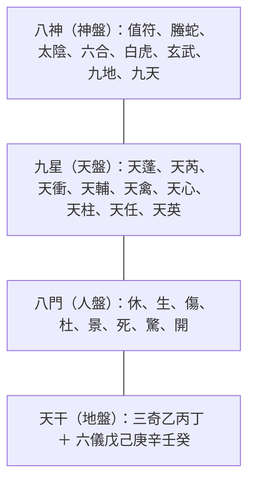

# 奇門遁甲

奇門遁甲是古代的術數，和大六壬、太乙神數並稱「三式」。它把**九星、八門、八神、天干**四層符號疊在洛書九宮上，用來判斷某個時辰、某個方位適不適合行動，古代主要用於兵法。

對修仙遊戲來說，它是最完整的「陣法盤」藍本：一張 3×3 的盤，四層會轉動的符號，每兩小時換一次格局。

## 名稱由來
- **奇**：天干中的乙、丙、丁，稱「三奇」。
- **門**：休、生、傷、杜、景、死、驚、開，稱「八門」。
- **遁甲**：天干裡「甲」最尊貴而不露面。六甲（甲子、甲戌、甲申、甲午、甲辰、甲寅）藏在戊、己、庚、辛、壬、癸這「六儀」之中，甲本身不佔一宮，所以叫「遁甲」。

## 盤的四層

## 九宮（地盤基礎）
九宮來自[[河圖洛書|洛書]]，每宮配一個[[八卦]]與方位。中宮（5）沒有方位、不設門，落在中宮的星或門會「寄」到坤二宮。

| 4 巽・東南 | 9 離・南 | 2 坤・西南 |
| :-: | :-: | :-: |
| **3 震・東** | **5 中宮** | **7 兌・西** |
| **8 艮・東北** | **1 坎・北** | **6 乾・西北** |

## 九星（天盤）

| 星 | 本宮 | 五行 | 吉凶（常見分法） |
| --- | --- | --- | --- |
| 天蓬 | 坎 1・北 | 水 | 大凶 |
| 天芮 | 坤 2・西南 | 土 | 大凶（病星） |
| 天衝 | 震 3・東 | 木 | 小吉 |
| 天輔 | 巽 4・東南 | 木 | 大吉 |
| 天禽 | 中 5 | 土 | 大吉 |
| 天心 | 乾 6・西北 | 金 | 大吉 |
| 天柱 | 兌 7・西 | 金 | 小凶 |
| 天任 | 艮 8・東北 | 土 | 小吉 |
| 天英 | 離 9・南 | 火 | 小凶 |

九星有固定的本宮，排盤時會隨局數在天盤上轉動。

## 八門（人盤）

| 門 | 本宮 | 五行 | 吉凶 |
| --- | --- | --- | --- |
| 休門 | 坎・北 | 水 | 吉 |
| 生門 | 艮・東北 | 土 | 吉 |
| 傷門 | 震・東 | 木 | 凶 |
| 杜門 | 巽・東南 | 木 | 平 |
| 景門 | 離・南 | 火 | 平 |
| 死門 | 坤・西南 | 土 | 凶 |
| 驚門 | 兌・西 | 金 | 凶 |
| 開門 | 乾・西北 | 金 | 吉 |

## 八神（神盤）
值符、螣蛇、太陰、六合、白虎、玄武、九地、九天。八神疊在星與門之上，加強、壓制或改變該宮的氣。有些流派的陰遁盤用勾陳、朱雀取代白虎、玄武。

## 時間如何驅動盤面
- **陽遁、陰遁**：冬至到夏至用陽遁（順排），夏至到冬至用陰遁（逆排）。
- **局數**：陽遁九局、陰遁九局，共十八局，大約每五天換一局。
- **時辰**：每個時辰（兩小時）星、門、神的位置都不同。
- **值符、值使**：當前時辰領頭的那顆星叫值符，領頭的門叫值使。

## 遊戲化點子
- **轉動的陣盤**：3×3 戰場，九星、八門、八神三層每回合轉一格，玩家要算準哪一格是「開門＋天心」的大吉位。
- **三奇加成**：乙、丙、丁落入的宮位給特殊加成，類似老虎機的 Wild。
- **遁甲**：主將（甲）隱身在六儀中，玩家要推理出藏在哪一格，適合做 Boss 機制。
- **陽遁、陰遁**：用季節或劇情階段切換順逆兩種轉法。

相關：[[陣法]]、[[九宮飛星]]、[[星宿]]、[[八卦]]、[[河圖洛書]]

## 來源
- [漢典「奇門遁甲」](https://www.zdic.net/hant/奇門遁甲)：名稱由來、三奇六儀
- [kinqimen（PyPI）說明](https://libraries.io/pypi/kinqimen/0.0.0.9)：三式、遁甲之義
- [Master Sean Chan 奇門排盤](https://www.masterseanchan.com/zh-hant/%E5%A5%87%E9%96%80%E9%81%81%E7%94%B2%E6%8E%92%E7%9B%A4-%E5%85%8D%E8%B2%BB/)：陽遁陰遁、局數、九星八門八神
- [Master Sean Chan 九星參考](https://www.masterseanchan.com/qi-men-dun-jia-9-stars/)：九星本宮與五行
- [Mystery Gates（stem-branch）](https://h4x0r.github.io/stem-branch/mystery-gates)：九宮與中宮寄坤
